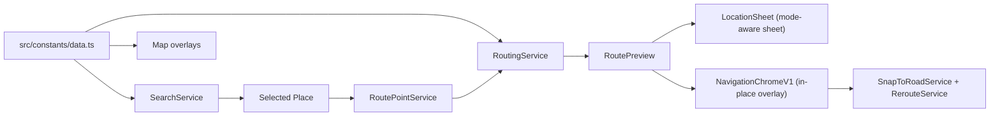
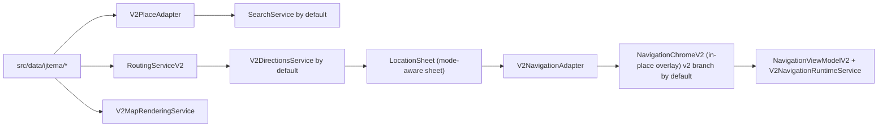

# Map Data Architecture

## Source Of Truth

The legacy v1 venue map is hardcoded in `src/constants/data.ts`. The authoritative v2 GIS/map source for B1-B42, official gates, Rasta 01-11, Shahr-e-Pindal routes, central points, and block entry points lives under `src/data/ijtema/*`.

The original manual marking process is not stored as a separate checked-in source file. Do not paste raw coordinate batches into screens, viewmodels, or services; keep v2 edits inside the focused files under `src/data/ijtema/*`.

There is no GeoJSON, KML, CSV, SVG, SQLite seed, remote config, checksum, or generated map package checked into this repository. v1 blocks, graph nodes, graph edges, landmarks, Member Masjid gates, and block entry overrides are manually represented as TypeScript objects for rollback and legacy tests. v2 keeps its manually marked dataset in focused TypeScript source files under `src/data/ijtema/*` and is the default production map/search/routing/navigation source.

## Legacy V1 Data Model

- `IJTEMA_DATA.nodes`: graph nodes and off-graph POI nodes. Graph nodes use `lat` and `lng`.
- `IJTEMA_DATA.edges`: walkable graph edges between nodes. Edges are treated as bidirectional by `RoutingService`.
- `IJTEMA_DATA.blocks`: block center points plus `corners`/`polygon` arrays. Blocks route through `entry_nodes`.
- `BLOCK_ENTRY_MAP_STRICT`: overrides each block's `entry_nodes` after block objects are declared.
- `LANDMARK_PLACES`: searchable POIs that are not graph nodes.
- `LANDMARK_NEAREST_NODE`: nearest graph node for off-graph landmarks and gates.
- `MAP_BOUNDS`: rectangular venue bounding box used as the venue/geofence test.

## V2 Data Model

- `src/data/ijtema/blocks.ts`: B1-B42 centers, polygons, entry points, aliases, labels, and visual metadata.
- `src/data/ijtema/gates.ts`: numbered official gates, coordinate availability, routing status, and entry/exit semantics.
- `src/data/ijtema/rastas.ts`: Rasta 01-11 named visual and graph polylines.
- `src/data/ijtema/specialRoutes.ts`: Shahr-e-Pindal North, South, and West visual routes.
- `src/data/ijtema/centralPoints.ts`: P1-P12 central graph points.
- `src/data/ijtema/navigationGraph.ts` and `graphBuilder.ts`: generated-in-code v2 graph nodes and edges from the v2 source files.
- `src/data/ijtema/mapBounds.ts`: broad map camera/download bounds and default region, not the outside-user routing policy by itself.

Both flows are map-first: there is no dedicated Directions or Navigation screen/route. `HomeScreen` owns a single shared `MapView` and switches what renders as siblings of it — `LocationSheet` (a mode-aware bottom sheet, `mode: 'routePreview' | 'preview' | 'details'`) for route setup, and `NavigationChromeV1`/`NavigationChromeV2` (overlay chrome, not a screen) once `MapMode` (see `src/viewmodels/useMapMode.ts`) reaches `NAVIGATION`/`ARRIVAL`. `RootNavigator` has no `NavigationScreen` or `DirectionsScreen` route.

## Legacy V1 Flow

## V2 Flow

## Rendering

Legacy v1 rendering (block polygons, graph edges from `IJTEMA_DATA`, and the `NavigationChromeV1` overlay) only activates when the v2 feature flags are explicitly set to false for rollback/dev testing — it renders in-place over `HomeScreen`'s `MapView`, not on a separate screen. Legacy Navigation can render a graph-only map without a Google Maps key by using `MapView` with `mapType="none"`.

The v2 Home path renders B1-B42, Rasta 01-11, Shahr-e-Pindal routes, gates, selected block highlights, and graph-only fallback layers through `V2MapRenderingService` by default. `EXPO_PUBLIC_USE_IJTEMA_V2_MAP=false` is an emergency rollback, not the production default.

The v2 Directions path uses v2 routing by default. It exposes active v2 Start Navigation when all three v2 flags are enabled or unset:

- `EXPO_PUBLIC_USE_IJTEMA_V2_MAP=true`
- `EXPO_PUBLIC_USE_IJTEMA_V2_ROUTING=true`
- `EXPO_PUBLIC_USE_IJTEMA_V2_NAVIGATION=true`

Unset values are treated as true for production. Explicit `false`, `0`, `no`, or `off` disables the related v2 path for rollback. The v2 Navigation path is isolated from the legacy `NavigationViewModel`. `HomeScreen` renders the `NavigationChromeV2` overlay only when the active route has `sourceVersion === "v2"` and the v2 navigation flag is enabled. Otherwise, legacy routes continue through the legacy runtime via `NavigationChromeV1`, and v2 routes remain preview-only or show a disabled message.

## Runtime Status

- Code/test status: v2 Search, Home rendering, Directions, and active Navigation are the default local production path and pass the local TypeScript, lint, and v2 script test gates.
- Android visual QA: pending. Do not claim runtime PASS until Android SDK/ADB device verification completes.
- Production readiness: not claimed. The branch is ready for Android runtime QA, not production release.

## Risks

- Hardcoded map data is difficult for non-developers to update safely.
- `corners` and `polygon` duplicate the same coordinates for each block.
- Edge distances are manually stored and can drift from measured distances.
- V1 and v2 systems coexist because v1 remains an explicit rollback/dev path, so feature-flag combinations require regression testing.
- There is no external versioned map package or checksum metadata yet.
- Android visual runtime behavior is still unverified in this environment.

## Recommended Future Shape

- Keep a human-editable GeoJSON source for blocks, gates, rastas, terminals, landmarks, and venue boundary.
- Generate TypeScript/JSON route data from that source.
- Store graph nodes/edges in a versioned map package with checksum metadata.
- Add a visual QA export that renders blocks, gates, labels, and route graph.
- Keep smoke tests for every block/gate/landmark route.
