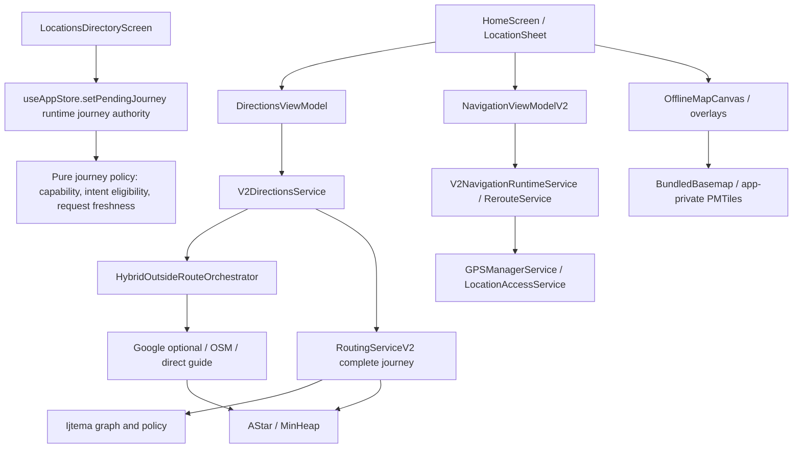

# B1: private offline-navigation SDK architecture RFC

Status: proposed for owner approval, not an implemented SDK. Issue [#134](https://github.com/ghilmanITM360/offline-map/issues/134). Owner authorized B1 on 2026-10-12 after internal Phase A; this supersedes that issue's historical APK prerequisite for documentation only. Public release remains gated.

## Verified baseline and scope

Inspected canonical `6996b7ef1b352d11b8820c697cefe2e1a6c150f0` and existing feature branch `feat/muslim-ummah-offline-navigation-sdk`, initially identical with no unique commits. One registered checkout: `/Users/ghilmanislam360/GhilmanProjects/offline-map`. Origin `https://github.com/ghilmanITM360/offline-map.git`. No worktrees, clones, native projects or dependencies created. Known untracked `.codex/environments/environment.toml` stays private and excluded.

[Project status](../PROJECT_STATUS.md), [architecture](../ARCHITECTURE.md), [routing](../OFFLINE_NAVIGATION_AND_ROUTING.md), [flows](../PRODUCT_AND_USER_FLOWS.md), [data maintenance](../DATA_MAINTENANCE.md), [basemap](../OFFLINE_BASEMAP.md) and [recovery disposition](../WORKSPACE_CONSOLIDATION.md) govern current behavior. Earlier source validation 165 suites/1,602 tests belongs to Phase A, not new native evidence. B1 changes documentation only.

## Decision proposal

Choose a private npm-workspace TypeScript React Native library `@muslim-ummah/offline-navigation`, with a headless internal domain and React Native presentation/adapters. Both React Native apps consume one engine; neither accesses private Zustand stores or ViewModel refs. Initially support the installed Expo 54/RN 0.81.5/New Architecture stack only. Pure domain can run in Node; this is not a promise of native-only Swift/Kotlin or other-framework hosts.

| Form | Fit and decision |
| --- | --- |
| RN TypeScript library with adapters | Reuses current MVVM and map overlays; selected implementation form. |
| Separate Swift/Kotlin SDK wrappers | Would require JS hosting or a second engine; defer until an actual native-only consumer requirement. |
| Internal workspace package | Selected delivery form for the RN library: one repository/lockfile, consumer fixtures, private release policy. |
| Copy app or publish entire HomeScreen | Reject: copies routing or leaks app stack/global state; too coupled for two consumers. |
| Headless-only library | Useful internal seam, insufficient for shared Directions/accessibility behavior; offer headless and RN entrypoints together. |

## Current dependency graph and proposed seam



Provider order belongs to orchestration; full journey gate cost belongs to RoutingServiceV2. Google is optional and currently diagnostic-enabled; default fallback chain is OSM → labelled direct guide. A direct guide is never a walking-road route. MapLibre renders map geometry; it is not a route engine.

Target: host stack/theme/auth/general settings/analytics-consent → public controller/provider → private journey commands/ViewModels → routing domain/data ports; map components and native adapters consume the same controller. Exactly one foreground session per controller, one presentation lease, no module-global shared authority across apps or providers. Lifecycle state and derived MapMode remain separate internally; do not undo the settled current ownership contract.

## Incremental repository shape

Current root app stays in place through domain/data/UI extraction. First add `packages/offline-navigation/src/domain/` with compatibility re-exports at old paths, then injected data ports. No initial move into `apps/ijtema`. Proposed eventual layout:

```text
offline-map/
  apps/ijtema/              # only after separate native/tooling migration
  apps/muslim-ummah/        # B8, independent app IDs/release lifecycle
  packages/offline-navigation/
  packages/offline-data-contracts/ # only when shared pack contracts justify it
  venue-data/karachi-ijtema/ # serialized data, not executable TS packs
  docs/sdk/
  scripts/
  package.json             # one lockfile, private workspace root
  .git/
```

Introduce workspaces only at B5 after Metro/autolinking consumer proof. Until then extract through root-compatible imports; package directory does not imply package publication. Preserve root Android scripts, app identity and v1 rollback. Remove compatibility re-exports only after all consumers and scripts use the stable boundary. Independent apps may ship different SDK versions over time, but each binary must resolve one tested RN/native dependency set; no duplicate implementations in one repository.

## Documents and approval decisions

- [Module extraction matrix](MODULE_EXTRACTION_MATRIX.md)
- [Public API](PUBLIC_API_CONTRACT.md)
- [Platform compatibility](PLATFORM_COMPATIBILITY.md)
- [Offline pack spec](OFFLINE_PACK_SPEC.md)
- [Implementation roadmap](IMPLEMENTATION_ROADMAP.md)
- [Test/release gates](TEST_AND_RELEASE_GATES.md)

Approve: internal RN workspace architecture and foreground-only initial scope; controller API/one presentation lease; immutable pack model/signature/trust ownership; first B2 algorithm extraction. Keep native-only wrappers, background navigation, arbitrary host map renderers and app-root relocation deferred. Signing keys, distribution operator, size-budget values and Muslim Ummah IDs require owner inputs before related implementation. No approval to migrate source is inferred from delivery of this RFC.

## B1 review and validation record

2026-10-12: independent read-only architectural review checked source inventory, platform claims and controller/lifecycle design. Three findings were resolved: SDK-owned one-shot automatic destination intent, typed manual gate selection/reset, and app-runtime GPS arbitration across controllers. Follow-up review found no blocking architectural findings. Owner design approval remains pending; technical review does not authorize B2.

Lightweight validation: seven documents, 16 local Markdown links and 58 distinct existing source paths checked; no missing references or unbalanced code fences. Proposed public TypeScript declarations compiled with installed TypeScript5.9.3 using strict/noEmit, DOM/ES2022 libs and skipLibCheck. `git diff --check` passed. No source/config/package/lock/native files changed; expensive source suites were not rerun for this docs-only milestone. Web references were consulted as official guidance, with installed defaults distinguished from native dependency resolution. No new native/runtime/security acceptance is claimed. Account short-term/weekly percentages were not accessible; none were inferred.
